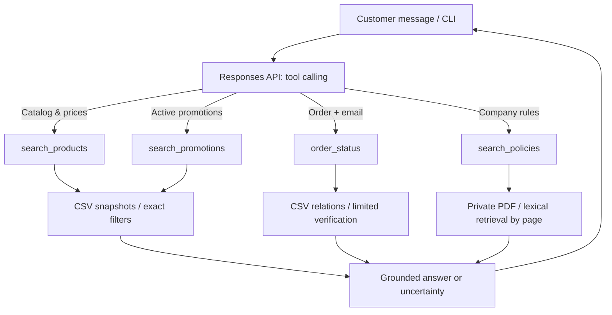

# Music Emporium — AI Customer Support Agent

**Artefact technical case · AI Engineer / Full-Stack Applications with Generative AI**  
**Implementation:** Python · OpenAI Responses API function calling · deterministic CSV queries · citation-based PDF retrieval · CLI

> **Validation status:** All offline tests pass on the supplied challenge data and on separate, public synthetic fixtures. **A real OpenAI API call has NOT been executed in this environment.** Do not interpret the recorded offline conversations as live LLM responses.

## What this project does

This read-only text agent supports a fictional musical-instrument retailer in Campo Grande, Brazil. It answers customer questions in Brazilian Portuguese while choosing the right information source:

- Product names, categories, availability, pricing and active promotions → structured CSV lookups.
- Order status and shipment tracking → verified `orders → customers` lookup, with the customer providing the order ID and purchase email.
- Opening hours, returns, warranty, delivery, payment conditions and store contact → excerpts from the store-policy PDF, with page references.
- Out-of-scope requests → courteous refusal and redirection to store-related assistance.

The prototype **does not** place orders, issue refunds, cancel purchases, change inventory, write customer data or make shipment promises.

## Architecture



**Why a hybrid agent?** Product prices, stocks, relational joins and discounts must be computed deterministically, not retrieved by natural-language similarity. The small policy document is best handled by directly retrieving relevant source pages instead of creating a vector database and embeddings infrastructure for eight pages. The LLM decides when to call tools and composes a succinct, grounded response.

**Why not LangChain, an SQL agent or an autonomous ReAct loop?** There are four read-only, strictly defined functions, no actual database connection, and no need for unbounded planning. A small explicit loop is easier to reason about, test and secure. The loop is bounded to six model turns, and conversation state lives only in process memory.

**LLM choice:** `gpt-4.1-mini` is a configurable default, selected as a small function-calling-capable baseline. Set `OPENAI_MODEL` to another model supported by your own API account if needed. No API cost or quality claims are made without a live test.

## Installation and running

Python **3.11+** required.

```bash
python -m venv .venv
# Linux/macOS:
source .venv/bin/activate
# Windows PowerShell:
# .venv\Scripts\Activate.ps1
pip install -e ".[dev]"
```

**Option A — offline, reproducible demonstration (no API key):**

```bash
python -m emporio_agent inspect --data-dir demo_data
python -m emporio_agent chat --data-dir demo_data --offline --trace
pytest -q
```

The `--offline` switch invokes a **limited deterministic demonstrator**, not an LLM. It uses the same read-only CSV and PDF lookup components, and is designed for verifying source behavior without incurring API charges. Five real recorded demonstrations are in [`examples/`](examples/).

**Option B — real LLM tool-calling agent using the supplied case files:**

1. Put the original case files in a local `data/` directory using exactly these names: `products.csv`, `categories.csv`, `promotions.csv`, `orders.csv`, `order_items.csv`, `customers.csv`, `políticas_da_loja.pdf`.
2. Never commit these original files to a public repository.
3. Set your API key privately in an environment variable (the `OPENAI_API_KEY` variable). The `.env.example` is only a template; it is not automatically loaded.

```bash
# Linux/macOS:
export OPENAI_API_KEY="<your own key>"
export OPENAI_MODEL="gpt-4.1-mini"
# PowerShell:
# $env:OPENAI_API_KEY="<your own key>"
# $env:OPENAI_MODEL="gpt-4.1-mini"

python -m emporio_agent inspect --data-dir data
python -m emporio_agent chat --data-dir data --trace
```

To record **actual** model conversations (for personal review only until validated):

```bash
python scripts/record_live_examples.py --data-dir demo_data
# Creates live_examples_local_only/*.md (ignored by Git).
```

> A ChatGPT subscription does not automatically grant access or credits for the API. Tests and the offline demonstration run without an API key. The full LLM flow needs working network access and API credentials.

## Original data schema and business rules

The original local dataset was inspected, not inferred:

| File | Records | Main role |
|---|---:|---|
| `products.csv` | 65 | `product_id`, `name`, `category_id`, `price_brl`, `stock_quantity`, `status` |
| `categories.csv` | 9 | `category_id` → category display name |
| `promotions.csv` | 25 | `product_id`, `discount_percent`, `is_active` (4 active flags) |
| `orders.csv` | 20 | `order_id`, `customer_id`, `status`, tracking, estimated delivery |
| `order_items.csv` | 22 | `order_id`, `product_id`, `quantity` |
| `customers.csv` | 50 | `customer_id`, purchase e-mail for limited prototype verification |
| `políticas_da_loja.pdf` | 8 pages | Store policy manual v2.1 (June 2025), kept private |

Validated joins: `products.category_id → categories.category_id`, `promotions.product_id → products.product_id`, `orders.customer_id → customers.customer_id`, and `order_items → orders/products`.

**Pricing:** Current price uses a CSV promotion only when `is_active` is true and the product is available. `Decimal` arithmetic calculates the discounted amount with half-up rounding to cents. Regular price, current price and percentage are returned together. The 5% PIX discount is calculated **only for non-promotional products**, per the policy manual; discounts do not stack. The budget filter uses the **current promotional price**, not the optional PIX price.

**Availability:** Products must have `status=active` and `stock_quantity > 0`. `discontinued`, `coming_soon` and zero-quantity products are never marked in stock. All availability is based on a **CSV snapshot**, not real-time stock.

**Policy retrieval:** The `pypdf` extractor builds one searchable chunk per PDF page. Accent-insensitive lexical scoring and domain-specific keyword expansion rank the passages. The tool returns original page numbers and the relevant text; no made-up policy summaries or external web knowledge are added. Unclear conflicts are escalated.

## Quality assurance

Run:

```bash
pytest -q
python -m emporio_agent inspect --data-dir data
python scripts/record_examples.py --data-dir demo_data --out-dir examples
```

Offline automated tests cover correct joins, non-cumulative discounts, currency rounding, category inflections, genuine stock status, order verification and privacy, policy page retrieval, missing data, tool calling with a mock model response, and a reproducible multi-turn demonstration.

See [`reports/VALIDATION.md`](reports/VALIDATION.md) for exact results and [`docs/ACCEPTANCE_MATRIX.md`](docs/ACCEPTANCE_MATRIX.md) for the evaluation-requirements checklist. **The real hosted model and full end-to-end behavior still require manual API validation.**

## Risks, assumptions and limitations

- The supplied PDF labels itself **internal/restricted**. Original manual and customer records are intentionally excluded from this public-ready project; `demo_data/` contains unrelated, clearly marked synthetic replacements.
- The source manual has contact-channel discrepancies (pages 2 and 6) and requires careful distinction between the 30-day exchange procedure and 90-day legal warranty (pages 4 and 7). The agent is instructed to flag ambiguity rather than over-promise.
- Comparing order ID + purchase email is a minimal prototype measure, **not secure authentication**. A production system needs an authenticated account or independent one-time verification; passing raw customer emails to an LLM provider also requires appropriate privacy controls.
- The CSVs contain old snapshot records. The agent does not synchronize inventory, shipments or campaigns and cannot confirm historical delivery dates are still meaningful.
- `is_active` is the only campaign-activity signal; no dates are provided. A flagged campaign is not proof of live availability today.
- The lexical retriever can miss unusual paraphrases. It has no semantic embeddings, ranking calibration or multilingual retrieval evaluation.
- Answers are not audited by a human in production; no ticketing, payment or order-mutation tools are implemented. The model may make errors despite grounding instructions.
- No hosted API integration test, production security review, rate-limiting, metrics backend or load test has been performed.

**With more time:** validate the actual LLM output against a curated evaluation set, add authenticated access, human-handoff workflows, tracing (latency, tool success, faithfulness), domain-specific retrieval evaluation, freshness checks and safe automated regression evaluations.

## Use of AI coding assistance

**Disclosure:** This prototype, its original scaffold, source-schema adaptation, tests, examples and draft documentation were created with assistance from **ChatGPT (OpenAI, GPT-6)**. AI was used for code authoring and review; Python scripts and pytest were used to execute reproducible local checks. The final candidate should personally review the implementation and be able to explain each design decision. **No live API execution or independent human review is claimed here.**

The goal is a small, inspectable prototype with defensible design choices, not inflated engineering complexity.

## Project structure

```text
src/emporio_agent/   # Agent, business tools, policy retrieval, CLI, offline demo
scripts/             # Generate demo fixtures and capture demo/live conversations
tests/               # Synthetic unit tests + optional original-data integration tests
demo_data/           # Safe, 100% synthetic dataset and PDF for public demonstration
examples/            # Five captured, explicitly offline demo conversations
data/                # Private originals (ignored by Git; locally required for real case)
docs/                # Requirement traceability, architecture/safety notes
reports/             # Offline test results and source-data audit, no customer PII
```

## Delivery and GitHub publication

The case requests a **public Git repository** with meaningful commit history, a README and 3–5 examples, and says not to modify the repository after submission. A public-safe repository archive and a separate **local private** package are produced by the handoff workflow. Review both before publication; never commit `data/` or a secret.

The assignment PDF requests replying to the recruiter e-mail with a repository URL; the recruitment e-mail additionally requests a Google Form/PDF submission. Check both channels and use the earliest defensible deadline. No publication or application submission should be reported as complete without confirmation.
