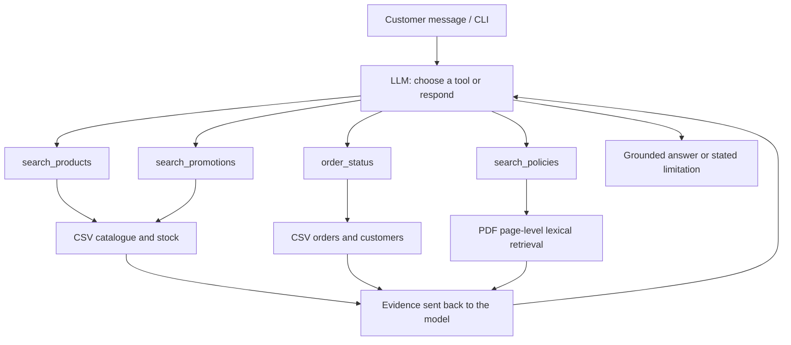

# Music Emporium — AI Customer Support Agent

**Artefact · AI Engineer technical challenge · Python prototype**

A musical-instrument retailer receives repetitive questions about products, prices, availability, deliveries and store policies. This project explores how a **read-only AI assistant** can answer those questions using the right source of evidence instead of relying on a model's memory.

**What is delivered:** a Python agent foundation with OpenAI Responses API function calling, four controlled lookup tools, six related CSV datasets, policy-document retrieval, a CLI, automated tests and five reproducible **offline** conversation examples.

> **Verification at a glance:** 31 local tests passed with the authorized original files; on a public-only checkout, 18 passed and 13 original-data tests were skipped. The hosted LLM flow is implemented **but has not been tested against the real API**. Offline examples are rule-based demonstrations, not recordings from an LLM.

## The problem and the product boundary

Empório da Música, a fictional instrument store in Campo Grande, Brazil, needs help with recurring customer requests. The goal is to reduce the effort required to locate accurate information—not to let an LLM invent stock levels, change an order or make refund decisions.

| Customer request | Agent behavior | Source |
|---|---|---|
| “Quais violões disponíveis custam até R$ 1.000?” | Filter by category, current price, catalogue status and stock; show available options | `search_products` → CSVs |
| “O Takamine GD20 está em promoção?” | Retrieve catalogue price and campaign flags; do not stack promotional and PIX discounts | `search_products` / `search_promotions` → CSVs |
| “Onde está meu pedido?” | Request the order ID and purchase email before a **limited prototype check**; do not disclose other customers' details | `order_status` → linked CSVs |
| “Me arrependi da compra, posso devolver?” | Find the applicable policy passage, cite its page and avoid promising an automatic refund | `search_policies` → PDF |
| Unrelated or unsupported request | State the limitation and redirect appropriately | Scope and tool-result rules |

The prototype **does not** take payments, modify orders, issue refunds, send messages, synchronize live inventory or access a real customer-support system.

## Run the project

Requires **Python 3.11+**. Start with the public, privacy-safe dataset; no API key is needed for inspection or offline tests.

```bash
python -m venv .venv
# Activate .venv (Windows PowerShell: .venv\Scripts\Activate.ps1; macOS/Linux: source .venv/bin/activate)
python -m pip install -e ".[dev]"
python -m emporio_agent inspect --data-dir data_public
pytest -q
python -m emporio_agent chat --data-dir data_public --offline --trace
```

Try: `Quais violões disponíveis custam até R$ 1.000?` The public CSV snapshot contains **12 matching instruments**; the CLI displays up to eight at a time. Tool traces show the tool name and status without printing customer data. The `--offline` switch is a **deterministic demonstration**, not an LLM.

To exercise actual model-driven tool selection, configure your own API credentials privately and run **without** `--offline`:

```bash
# Set OPENAI_API_KEY in your environment; optionally set OPENAI_MODEL.
python -m emporio_agent chat --data-dir data_public --trace
```

This is an **optional, unverified live path**; it requires working credentials, internet and API usage. A ChatGPT subscription does not itself include API credits. The CLI defaults to the configurable `gpt-4.1-mini` model; no quality, latency or cost benchmarks are claimed.

**Using the original Artefact materials:** place `products.csv`, `categories.csv`, `promotions.csv`, `orders.csv`, `order_items.csv`, `customers.csv` and `políticas_da_loja.pdf` in the Git-ignored `data/` folder, then replace `--data-dir data_public` with `--data-dir data`. Do not commit these private originals.

## How it works



The tools are **read-only**. The model chooses *which* function to call; Python performs the catalogue joins, price arithmetic, stock filtering and order checks. Policy passages are retrieved from a PDF using lightweight, page-level lexical matching; **this is not vector search or an embeddings pipeline**. The function-calling loop is bounded and avoids arbitrary code or SQL execution.

The current design is intentionally small: adding LangGraph, an SQL agent or a vector database should solve a **measured limitation**, not merely increase the technology count. See [architecture and trade-offs](docs/ARCHITECTURE_BRIEF.md) and the [decision record](docs/DECISION_REGISTER.md).

## Evidence and limitations

| What was checked | Current evidence |
|---|---|
| Dataset integrity | Six CSV types; 65 products, 9 categories, 25 promotions, 20 orders, 22 order items and 50 customers; joins checked |
| Catalogue and promotions | Deterministic price, stock and non-cumulative discount checks passed |
| Policy retrieval | Original eight-page manual retrieved locally with page references; public PDF is a **one-page synthetic fixture** |
| Automated tests | **31 passed** with original files available locally; **18 passed, 13 skipped** on public-only setup |
| Conversation examples | **Five offline, deterministic** transcripts, generated by a script and clearly labelled |
| Hosted LLM tool selection, answer accuracy, cost and latency | **Not yet evaluated** on the actual API |

The published `data_public/` set preserves original non-personal product/category/promotion/item rows but **replaces identifying customer fields, tracking details and notes**. The source policies document is marked internal and is therefore not published. The order ID + purchase email check is useful only to demonstrate the read path; **it is not production authentication**. CSV values are snapshots, not real-time business data.

Read the [test log](reports/VALIDATION.md), [12-scenario evaluation plan](docs/EVALUATION_PLAN.md), [security notes](docs/SECURITY.md) and [assignment traceability](docs/ACCEPTANCE_MATRIX.md). A live model evaluation and stronger identity verification are the main unresolved engineering tasks.

## Development approach and AI assistance

The first executable baseline was produced through an **AI-assisted engineering workflow**: the case brief and datasets were provided to ChatGPT, which helped generate the initial Python implementation, tests and documentation. Prior work exploring agent orchestration in the separate **Pandora** project informed the review of tool boundaries, context and verification; Pandora code or infrastructure was **not** integrated here.

After the baseline was built, the candidate identified the need for **explicit architecture review and ownership**, selected a pragmatic engineering + applied AI direction and introduced a decision register and evaluation plan. Initial choices that were generated with assistance are not represented as independently candidate-designed. The next step is a reproducible technical review and a bounded live evaluation, not more unmeasured complexity.

See [the development journey and evidence](docs/AI_ASSISTED_ENGINEERING_CASE_STUDY.md). This disclosure is part of the assignment's requirement to explain how AI coding assistance was used.

## Project navigation

| Area | Contents |
|---|---|
| [`src/emporio_agent/`](src/emporio_agent/) | Agent loop, CLI, CSV tools, PDF retrieval, offline demo |
| [`data_public/`](data_public/) | Public working data with documented provenance and redaction |
| [`examples/`](examples/) | Five transparent offline example conversations |
| [`tests/`](tests/) | Unit, data-integrity and original-data integration tests |
| [`docs/ARCHITECTURE_BRIEF.md`](docs/ARCHITECTURE_BRIEF.md) | Architecture, alternatives and rationale |
| [`docs/AI_ASSISTED_ENGINEERING_CASE_STUDY.md`](docs/AI_ASSISTED_ENGINEERING_CASE_STUDY.md) | How the initial working baseline was created and reviewed |
| [`reports/VALIDATION.md`](reports/VALIDATION.md) | Reproducible results and what remains unverified |

**Submission note:** the recruiter supplies the actual deadline and delivery channels. Review the project and do not modify the repository after submitting it, as required by the technical challenge.
