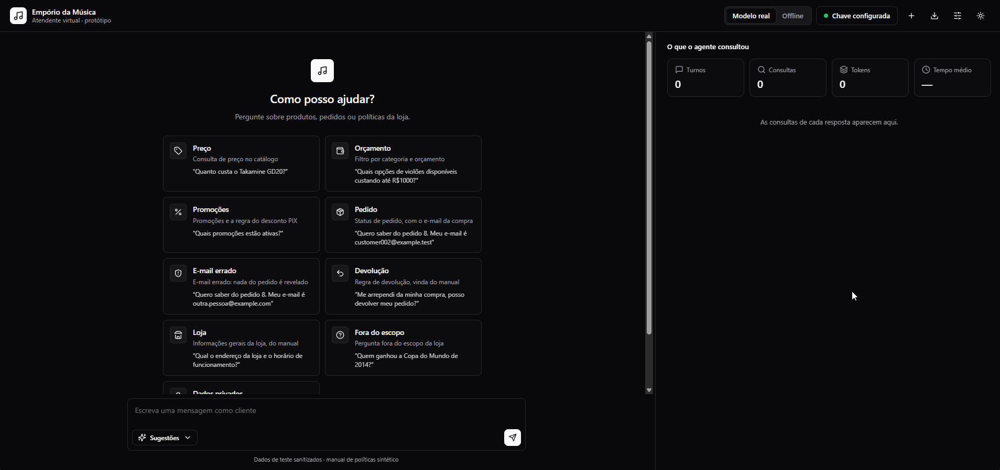
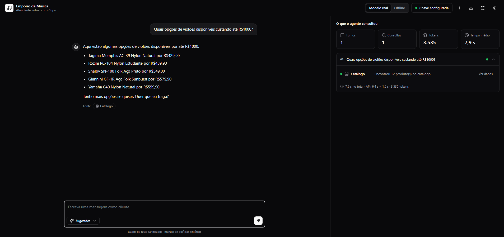
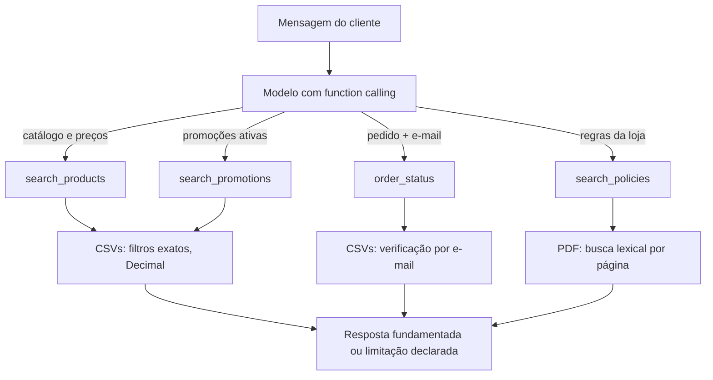

# Empório da Música · Atendente virtual

[](https://github.com/Gabriel300p/music-emporium-ai-agent/actions/workflows/ci.yml)

Agente de atendimento em Python para uma loja fictícia de instrumentos musicais (Campo Grande/MS), feito para o **desafio técnico de AI Engineer da Artefact**. Um modelo de linguagem decide quando consultar o catálogo, os pedidos ou o manual de políticas da loja e responde em português com base no que as ferramentas devolveram.

**Em uma tela:** [Teste em 2 minutos](#teste-em-2-minutos) · [Resultados](#resultados-medidos) · [Decisões](docs/DECISOES.md) · [Avaliação](docs/AVALIACAO.md) · [Como foi construído](docs/PROCESSO.md)

## O que este projeto demonstra

- **Separação entre o modelo e o que precisa ser exato.** O modelo escolhe qual ferramenta chamar; Python faz as contas de preço, desconto e estoque, filtra produtos e verifica pedidos. O modelo não calcula nem inventa esses dados.
- **Qualidade medida, não suposta.** Uma bateria de 28 cenários roda o modelo real (3 repetições cada) e checa a ferramenta escolhida, os valores na resposta, a privacidade e a resistência a injeção de prompt. A evolução e as falhas encontradas estão em [`docs/AVALIACAO.md`](docs/AVALIACAO.md).
- **Honestidade sobre o que falha.** Cada limitação conhecida está documentada com o número que a sustenta, inclusive a busca de políticas, que ainda erra em paráfrases.
- **Verificação automática em Linux e Windows.** A cada envio, o CI roda os testes nos dois sistemas, o lint, a cobertura (91%) e executa o `run.bat` num Windows de verdade.
- **Produto testável por qualquer pessoa.** Um comando instala tudo e abre uma interface web local com progresso em tempo real, texto em streaming e o painel "o que o agente consultou".

## Teste em 2 minutos

Requisito: **Python 3.11 ou mais novo** ([python.org/downloads](https://www.python.org/downloads/); no Windows, marque "Add python.exe to PATH").

| Sistema | Como abrir |
|---|---|
| **Linux / macOS** | `./run.sh` (ou `bash run.sh`) |
| **Windows** | duplo clique em `run.bat` |

Na primeira vez, o programa cria um ambiente isolado em `.venv/` e instala as dependências (cerca de 1 minuto, precisa de internet). Depois abre o navegador em `http://127.0.0.1:8765`. Para desfazer, apague a pasta `.venv/`.

1. **Sem chave de API**, o modo **Offline** já funciona: respostas por **regras**, sem modelo de linguagem e sem custo, com texto completo, ritmo de conversa e o aviso "respostas por regras" na tela. Serve para explorar o produto; **não demonstra a qualidade do modelo**.
2. **Para ver o modelo de verdade**, clique em **Chave**, cole uma chave de API da OpenAI e escolha **Modelo real**. A chave fica só na memória do programa: não é gravada em arquivo, não aparece em logs nem na conversa exportada. Quem não tiver chave pode ler as [conversas reais gravadas](examples/).
3. Clique numa sugestão da tela inicial ou use o botão **Sugestões** no campo de texto (cada uma diz o que testa).
4. À direita, **"O que o agente consultou"** mostra, por resposta, quais fontes foram usadas, o tempo de cada chamada ao modelo e, em **Ver dados**, a saída bruta como prova.





> **Dados em uso:** `data_public/`, uma versão sanitizada (clientes anonimizados). O manual de políticas dessa pasta é um documento **sintético de uma página**; o manual interno de 8 páginas do desafio não está neste repositório.
>
> **Plataformas:** o `run.sh` foi testado em Linux (WSL2). O `run.bat` é executado a cada envio num Windows do GitHub Actions, em três cenários (pasta local com espaço e acento, caminho de rede estilo WSL com uma `.venv` do Linux presente, e uma segunda execução que reaproveita o ambiente). O ambiente do Windows fica em `%LOCALAPPDATA%\EmporioAgent`, fora da pasta do projeto. **Ainda não foi confirmado no computador do autor.** Se o `.bat` falhar, copie a pasta para o disco local (por exemplo `C:\projetos`) ou use os comandos manuais abaixo.

<details>
<summary>Sem o lançador: comandos manuais</summary>

```bash
python3 -m venv .venv
.venv/bin/pip install -e ".[dev]"
.venv/bin/python -m emporio_agent serve       # interface web (opções: --port, --no-browser, --base-url)
.venv/bin/python -m emporio_agent chat --data-dir data_public --offline --trace   # terminal, sem chave
.venv/bin/python -m emporio_agent chat --data-dir data_public --trace             # terminal, com OPENAI_API_KEY
.venv/bin/pytest -q
```

No **Windows (PowerShell)**, o equivalente é:

```powershell
py -3 -m venv .venv
.venv\Scripts\pip install -e ".[dev]"
.venv\Scripts\python -m emporio_agent serve
```

A chave também pode vir da variável `OPENAI_API_KEY` ou de um `.env` local (veja `.env.example`; o `.env` é ignorado pelo Git). A variável `OPENAI_BASE_URL` do ambiente é ignorada de propósito: o endpoint é `api.openai.com`, a menos que se passe `--base-url`.
</details>

## O que o agente faz

| Pedido do cliente | Fonte | Comportamento |
|---|---|---|
| Preço, estoque, faixa de preço | `search_products` → CSVs | Filtra por categoria, orçamento e status; usa o preço promocional; nunca mostra produto descontinuado como disponível |
| Promoções | `search_promotions` → CSVs | Só promoções ativas de produtos disponíveis; o desconto de PIX **não** soma com promoção |
| Status de pedido | `order_status` → CSVs | Exige número do pedido **e** e-mail da compra; sem os dois, nada é revelado |
| Horário, endereço, pagamento, troca, devolução, garantia | `search_policies` → PDF | Traz o trecho do manual com a página; sem evidência, diz que não sabe e encaminha à equipe |
| Fora do escopo | (nenhuma) | Recusa com educação e volta ao que a loja atende |

O agente **não** compra, troca, reembolsa nem altera dados. Catálogo e pedidos são um retrato em CSV, não estoque em tempo real.

## Arquitetura



| Decisão | Escolha | Por quê (detalhes e alternativas em [`docs/DECISOES.md`](docs/DECISOES.md)) |
|---|---|---|
| Orquestração | *Function calling* direto, 4 ferramentas só de leitura, laço de até 6 voltas | Poucas ferramentas e fluxo sem ramificação; ReAct em texto ou LangGraph só trariam código e dependências sem ganho medido |
| Dados estruturados | Funções Python sobre CSVs em memória | Preço e estoque exigem conta exata; um agente de SQL daria ao modelo acesso à tabela de clientes e resultados não reproduzíveis |
| Políticas | Busca lexical por página, com sinônimos, citando a página | Manual de 8 páginas curtas; embeddings seriam infraestrutura demais. **Limite medido:** falha em paráfrases |
| Modelo | `gpt-4.1-mini`, configurável | Modelo pequeno com chamada de ferramentas. Comparei latência com outros modelos: ficaram na mesma faixa (≈2 s por resposta) |
| Interface | Web local (só biblioteca padrão) e CLI | O foco é o agente; a página existe para qualquer pessoa testar sem terminal |

## Resultados medidos

| O que | Resultado | Como reproduzir |
|---|---|---|
| Testes automáticos (sem rede, sem chave) | **121 passam, 13 pulados** num clone público (os 13 exigem os arquivos originais privados). **Cobertura de 91%** do pacote, medida com `coverage`. Passam em Linux e Windows, Python 3.11 e 3.12 | `pytest -q` · CI |
| Bateria com o modelo real: 28 cenários × 3 repetições | **83 de 84 corretas** na última rodada; a falha é a paráfrase de política, que oscila entre rodadas (de 4 a 9 acertos em 10 repetições), então esse número não é uma garantia | `python scripts/eval_live.py --rep 3` |
| Privacidade e segurança nessa bateria | 0 vazamentos de dado pessoal, 0 preços inventados, 0 instruções injetadas obedecidas (inclusive uma escondida no nome de um produto) | idem |
| Tempo por resposta | 1,7 a 3,2 s no ambiente de desenvolvimento, quase todo em duas chamadas seguidas à API; cada ferramenta local leva de 0,05 a 2 ms. Rodando na máquina do autor foram observados 5 a 10 s (causa em investigação, provavelmente rede) | painel "O que o agente consultou" mostra o tempo de cada chamada |

A bateria usa `data_public/` e um modelo só. A rubrica é automática e foi escrita pelo autor; mede regressão, não "qualidade de redação". Detalhes, evolução e limites em [`docs/AVALIACAO.md`](docs/AVALIACAO.md).

## Atende ao enunciado?

| Pedido do enunciado | Onde ver |
|---|---|
| Python, agente de mensagens de texto com persona | `src/emporio_agent/` (o texto da persona está em `agent.py`) |
| Saber quando consultar dados e quando consultar políticas | 4 ferramentas em `agent.py`; cenários S01–S06 da bateria |
| Lidar com perguntas fora do escopo | cenários S10, S11, S13 e S14; [conversas gravadas](examples/) |
| Decisões justificadas no README | tabela acima e [`docs/DECISOES.md`](docs/DECISOES.md) |
| Instruções para rodar | seção "Teste em 2 minutos" |
| Limitações conhecidas e o que faria com mais tempo | seção abaixo |
| Uso de assistentes de código e *workflow* | seção "Como foi construído" e [`docs/PROCESSO.md`](docs/PROCESSO.md) |
| 3 a 5 conversas, ao menos uma não trivial | [`examples/`](examples/): 5 conversas reais com o modelo; a 3 combina a promoção do catálogo com a regra do PIX |
| Repositório público com histórico real | commits incrementais; os 5 primeiros vieram juntos (veja [`docs/PROCESSO.md`](docs/PROCESSO.md)) |

## Limitações conhecidas

- **Busca de políticas lexical.** Em 17 perguntas parafraseadas sobre o manual original, a página certa ficou em 1º lugar em 10 e entre as 3 primeiras em 14; 3 voltaram vazias. Depende de um mapa de sinônimos e de páginas escrito para a versão 2.1 do manual.
- **Autenticação de pedido fraca.** O e-mail é o único fator e os números de pedido são sequenciais. Depois de 3 pares errados seguidos a conversa é bloqueada, mas o limite é **por conversa**: abrir uma nova conversa zera o contador. Serve ao protótipo, **não à produção**.
- **Dados em retrato.** Sem estoque nem pedidos em tempo real; promoções só têm o indicador `is_active`, sem datas.
- **Avaliação limitada:** um modelo, 3 repetições, rubrica própria, manual sintético de 1 página nos testes com o modelo. Os cenários de paráfrase de política e de produto descontinuado oscilam entre rodadas.
- **A interface web é uma ferramenta local de um usuário:** sem login e sem persistência.

**Com mais tempo:** retrieval medido (BM25 por parágrafo antes de pensar em embeddings), autenticação por sessão ou código, datas de vigência nas promoções, dividir o módulo `web.py` (781 linhas), testes do JavaScript da página dentro do repositório, tipagem estática, registro estruturado de eventos, bateria com o modelo real no CI e mais de um modelo, e reexecução com o manual original.

## Como foi construído

- **Base inicial:** o código, os testes e a primeira documentação foram gerados com o **ChatGPT** (OpenAI), de uma vez. Por isso os primeiros commits são seguidos.
- **Revisão e evolução:** com o **Claude Code** (Anthropic), em sessões dirigidas por mim, fiz uma auditoria independente (testes, integridade das tabelas, regras de desconto, privacidade), escrevi a bateria de avaliação com o modelo real, a interface web, o lançador e as otimizações de desempenho.
- **O que eu decidi e testei:** a estratégia (equilíbrio entre engenharia confiável e IA aplicada), o escopo do produto, o que entra e o que sai da interface e a ordem das prioridades. Testei à mão e **encontrei defeitos que a avaliação automática não pegou** (pedido que falhava no meio de uma conversa, botão "Ver mais" sem efeito, demora de resposta); cada um virou correção com teste.
- **Verificação:** nada foi aceito sem execução. Os números deste README vêm de comandos rodados; as falhas estão descritas, não omitidas.

A história completa, com a linha do tempo, as regressões encontradas e como foram resolvidas, está em [`docs/PROCESSO.md`](docs/PROCESSO.md).

## Estrutura do projeto

```text
run.sh, run.bat       lançadores de um comando
src/emporio_agent/    agente, ferramentas, busca de políticas, CLI, interface web
.github/workflows/   CI: testes em Linux e Windows, lint, cobertura e o lançador run.bat
scripts/              bateria com o modelo real, geração de dados e de exemplos
tests/                testes automáticos
data_public/          dados sanitizados (clientes anonimizados, PDF sintético)
demo_data/            dados 100% sintéticos para a demonstração offline
examples/             5 conversas reais com o modelo + demonstração offline
docs/                 decisões, avaliação, segurança e processo
data/                 arquivos originais do desafio (ignorados pelo Git)
```

Os dados originais ficam em `data/` apenas localmente. Nunca versione essa pasta nem um arquivo `.env`.
