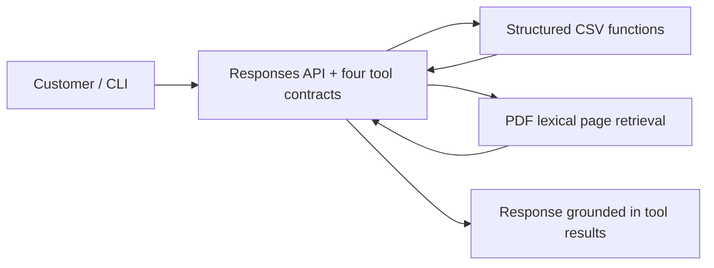

# Architecture and trade-offs

**Music Emporium · Python prototype · Baseline for technical review**

## 1. Product goal and constraints

Create a text-based assistant for repetitive customer-service questions in a musical-instrument store. It must distinguish **structured operational facts** (catalogue, stock, orders, promotions) from **written business policies** (returns, payment, store hours), stay within its scope and avoid unauthorized changes.

The assessment requires Python and allows a CLI; the provided catalogue is small and the original policy manual is eight pages. The source CSVs are snapshots, not live operational systems. Building a full admin frontend, cloud deployment or multi-agent framework would not directly demonstrate the core requirements.

## 2. Implemented baseline

| Concern | Implemented mechanism | Reason | Unverified/limited |
|---|---|---|---|
| Tool selection | Responses API function calling, bounded six-turn loop | Explicit allowed tools; no arbitrary code execution | Actual hosted-model routing **not tested** |
| Catalogue and money | Deterministic Python joins and `Decimal` calculations over CSV | No model-generated prices, stock or discounts | Snapshot freshness; no production data source |
| Store policies | Accent-insensitive page-level lexical retrieval from PDF | Small, inspectable manual; no embedding infrastructure needed initially | Paraphrase misses and ranking quality are unmeasured |
| Customer order | Exact order ID + purchase-email match | Demonstrates gated read-only path without returning contact fields | Not an authentication scheme for production |
| Interaction | CLI, short-lived in-memory history | Focus on agent behavior and simple reproduction | No browser/WhatsApp integration, persistent sessions or metrics backend |
| Offline verification | Unit tests, data-integrity tests and deterministic demonstration | Repeatable, no external API needed | Does **not** validate generated model responses |

## 3. What would justify a more complex approach?

| Decision | Baseline | Alternative | Trigger for adopting it |
|---|---|---|---|
| Retrieval | Page-level lexical search | Better lexical chunking/BM25, then embeddings or hybrid retrieval | Documented paraphrase/relevance failures in the same evaluation set |
| Orchestration | Direct tool loop | State machine, LangGraph or more explicit ReAct planning | Failed multi-step behavior or recovery needs demonstrably unsolved by the small loop |
| Data access | Typed Python functions over CSV | SQLite / read-only SQL layer | More relational query complexity, datasets or changing source updates |
| Model | Configurable function-calling model | Compare 2–3 supported providers/models | Measured differences in accuracy, tool use, cost and latency |
| Interface | CLI | HTTP API or minimal web UI | A validated need for accessibility, reviewer usability or channel integration |
| Identity | Matching two fields as a prototype | Authenticated accounts / one-time verification | Any access to real customer records in production |

These are **options for review**, not a claim that the candidate approved every early design decision. The initial tool-based architecture was created with AI assistance; the candidate later selected a pragmatic strategy and established explicit decision gates. See [decision register](DECISION_REGISTER.md).

## 4. Reliability and responsible behavior

- Do not provide pricing or stock without the relevant CSV lookup.
- Promotions use the CSV `is_active` flag and never stack their discount with PIX.
- Unavailable/discontinued products must not appear as currently for sale.
- Orders are read-only, with a limited verification gate; do not treat email matching as identity proof.
- Policy answers need an actual retrieved passage and page reference, and should escalate conflicts.
- Customer records, original tracking data and the internal policy manual stay outside public Git history.
- User messages and retrieved documents are treated as untrusted input to the model.

The project does not claim production-grade security, model evaluation, real-time business data or deployed customer traffic.

## 5. Evaluation-led next steps

The first priority is to validate the actual hosted model on a fixed set of scenarios before changing architecture. The [evaluation plan](EVALUATION_PLAN.md) defines test cases for tool choice, faithfulness to data and policies, disclosure avoidance and off-scope handling. Only after observing specific failures should the implementation compare retrieval or orchestration alternatives.

An implementation is not a design decision in itself: for future changes, record the **problem → options → evidence → choice → acceptance test → owner**. This is the human review gate introduced after the AI-assisted baseline.

## 6. Connection to Artefact's public engineering practice (external context)

Artefact's published work on [Groupe Barrière](https://www.artefact.com/cases/groupe-barriere-launching-the-first-tailor-made-generative-agents-kicking-off-groupe-barrieres-ai-roadmap/) discusses retrieval quality, user adoption and iterative response evaluation. Its [Chancerygate case](https://www.artefact.com/cases/how-chancerygate-built-four-claude-powered-agents-in-two-weeks-then-20-more-on-its-own-with-artefact/) describes rapid agent development paired with ownership and knowledge transfer. These are **Artefact's client results**, not evidence of this prototype's outcomes. The comparison reinforces a common engineering principle: fast prototyping is useful, but adoption and confidence require validation and responsibility.
